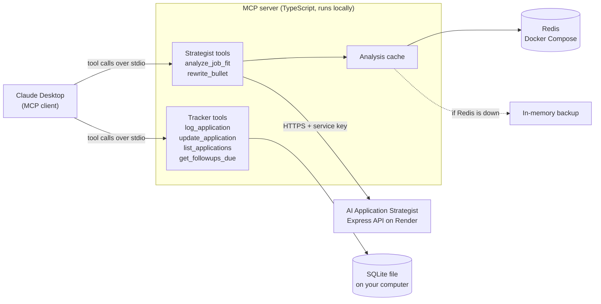
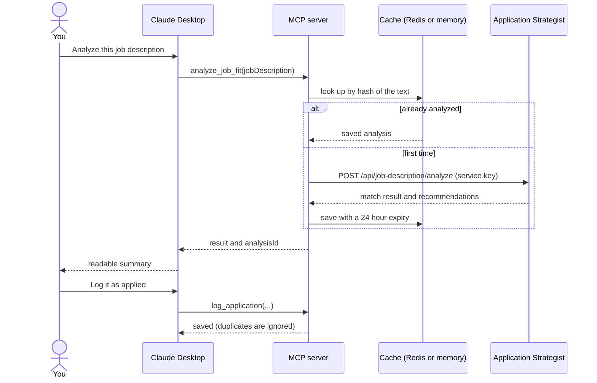

# Application Strategist MCP Server


<!-- If you rename the repository, update the badge link above and the clone URL below. -->

A [Model Context Protocol](https://modelcontextprotocol.io) (MCP) server that lets AI assistants such as Claude Desktop use my [AI Application Strategist](https://github.com/sujal-io/calibrate) and keep track of job applications, all inside one conversation.

Built with TypeScript, the official MCP SDK, Zod, SQLite, Redis and Docker Compose. Tested with Vitest and GitHub Actions.

<!-- Demo video: add a link or an embedded GIF here once it is recorded. -->

## What it does

The AI Application Strategist ([live demo](https://calibrate-eta.vercel.app/)) is a web app that analyzes how well a job description fits a stored resume and rewrites resume bullets for a role. On its own it can only be used by clicking through its website. This server opens a second door into it, built for AI assistants, and adds a small job-application tracker next to it.

That means one chat can do the whole loop:

```text
You:     Here is a job description: [pasted]. How well does it fit my resume?
Claude:  (calls analyze_job_fit) About an 80% match. Strong on Node.js and REST APIs,
         missing Docker. These resume bullets are the most relevant...
You:     Rewrite my best matching bullet for this role.
Claude:  (calls rewrite_bullet) Original: ...  Rewritten: ...  Please check it is accurate.
You:     I applied today through LinkedIn. Log it with that match score.
Claude:  (calls log_application) Saved.

A week later:
You:     What needs a follow-up?
Claude:  (calls get_followups_due) Acme, Backend Intern has been quiet for 7 days...
```

This is an illustrative conversation. The exact wording and numbers will differ.

Why this is more than the website: the output of one step feeds the next step automatically, and the same server works from any MCP-capable AI app without building a new interface for each.

## Architecture



What happens when you ask for an analysis:



Claude Desktop starts the server as a background process and talks to it over standard input and output (the MCP `stdio` transport). Nothing is exposed on the network.

## Tools

| Tool | What it does | Main inputs | Changes data? |
|---|---|---|---|
| `analyze_job_fit` | Compares a job description with the stored resume. Returns the match percentage, matching, missing and extra skills, recommendations, the most relevant resume bullets, and an `analysisId`. Repeat questions are answered from the cache. | `jobDescription` (50 to 20,000 characters), `refresh` (optional) | No |
| `rewrite_bullet` | Rewrites one resume bullet for the analyzed job. | `analysisId`, `bulletId` (from the analysis) | No |
| `log_application` | Saves a job application. Returns the existing record instead of creating a duplicate. | `company`, `role`, `appliedOn` (optional, `YYYY-MM-DD`), `source`, `jobUrl`, `matchPercentage`, `notes` | Yes |
| `update_application` | Changes the status, appends a dated note, or records that a follow-up was sent. | `id`, and at least one of `status`, `note`, `followedUp` | Yes |
| `list_applications` | Lists applications with their follow-up state. | `filter`: `active` (default), `all`, or one status | No |
| `get_followups_due` | Shows which applications need a follow-up now, and which have gone quiet. | none | No |

Statuses are `applied`, `interviewing`, `offer`, `rejected` and `withdrawn`.

### Follow-up policy

The rules live in one function (`src/tracker/followUpRules.ts`) and are easy to change:

- An `applied` application is due for a follow-up after 7 quiet days, an `interviewing` one after 5.
- At most 2 follow-ups. The clock restarts each time one is sent.
- After at least one follow-up and 14 more quiet days, the application is reported as gone quiet, so it can be closed.
- A status change starts a fresh follow-up count. The clock starts on the day you applied, not the day you logged it.

## Design decisions

- **A scoped service key instead of a login.** The Application Strategist normally requires a browser login through Clerk, which a program cannot perform. I added a second way in: a secret key sent in the `x-service-key` header. It is checked in constant time, maps to one owner account, is accepted only on three specific routes (job description analysis, bullet rewrite and calibration), and is switched off entirely if it is not configured (fail closed). That change lives in the Application Strategist repository.
- **Pass handles, not payloads.** The rewrite endpoint needs the structured job description produced by the analysis. Instead of making the AI carry that large object back and forth, the server remembers it and the AI passes a short `analysisId`.
- **The cache is an interface with three implementations.** `AnalysisStore` is implemented by an in-memory store, a Redis store, and a layered store that writes to both and reads Redis first. Tools never know which one they use. Keys are a SHA-256 hash of the whitespace-normalized job description, entries expire after 24 hours, and the memory store is capped at 50 entries.
- **A Redis outage never breaks a tool call.** The Redis client is configured to fail fast, and the layered store falls back to memory and reports the problem once. Redis is optional: without `REDIS_URL` the server runs on memory alone.
- **Failures become readable messages.** Every failure mode of the upstream API (bad key, missing resume, rate limit, server error, timeout, network error, unexpected response) is mapped to a plain-language tool error so the AI can explain it, instead of crashing the server.
- **Timeouts stay under the client's limit.** Many MCP clients give up on a tool call after about 60 seconds, so requests time out at 55 by default. Because free hosting sleeps when idle, the server also sends a warm-up request at startup.
- **Store facts, compute opinions.** The tracker saves the date of the last activity and the number of follow-ups. "Due" and "gone quiet" are calculated when asked, from the current date, so they can never be out of date.
- **Safe by construction.** All SQL uses bound parameters because the input comes from an AI. Logging is idempotent because AI clients can retry a call. Inputs and the upstream response are validated with Zod.

## Security notes

- The service key lives only in environment variables, never in the repository. `.env`, database files and build output are ignored by git.
- The tracker database is stored in the user's home folder, outside the repository.
- Redis is bound to `127.0.0.1` in `docker-compose.yml`, so it is not reachable from the network.
- Read-only tools are marked with `readOnlyHint`, so clients can skip approval prompts for them. Tools that write data are not.
- There is deliberately no delete tool. To reset the tracker, delete the database file.
- A leaked service key could run analyses against the stored resume and use the owner's AI quota, within the upstream hourly rate limits. If that happens, generate a new key and update both sides.

## Getting started

### Prerequisites

- Node.js 20 or newer
- Claude Desktop (or another MCP client)
- A running AI Application Strategist backend with the service-key change, and these two settings on that backend:
  - `MCP_SERVICE_KEY`: a long random value
  - `MCP_SERVICE_USER_ID`: the user ID that owns the stored resume
- Optional: Docker Desktop, for the Redis cache

Generate a key with:

```bash
node -e "console.log(require('crypto').randomBytes(32).toString('hex'))"
```

### Install and configure

```bash
git clone https://github.com/sujal-io/mcp-server.git
cd mcp-server
npm install
```

Copy `.env.example` to `.env` and fill it in (used by `npm run dev` and the test scripts):

```text
STRATEGIST_BASE_URL=https://your-service.onrender.com
STRATEGIST_SERVICE_KEY=the-same-key-you-set-on-the-backend
REDIS_URL=redis://127.0.0.1:6379
```

Use `127.0.0.1` rather than `localhost` for Redis. On some systems `localhost` resolves to a different address than the one Docker listens on.

### Optional: start Redis

```bash
npm run redis:up
```

### Build and connect to Claude Desktop

```bash
npm run build
```

Claude Desktop runs the compiled `dist/index.js`, so run `npm run build` again after every code change. Open Claude Desktop, then Settings, Developer, Edit Config, and add the server (see `claude_desktop_config.example.json`):

```json
{
  "mcpServers": {
    "application-strategist": {
      "command": "node",
      "args": ["C:\\path\\to\\mcp-server\\dist\\index.js"],
      "env": {
        "STRATEGIST_BASE_URL": "https://your-service.onrender.com",
        "STRATEGIST_SERVICE_KEY": "your-key",
        "REDIS_URL": "redis://127.0.0.1:6379"
      }
    }
  }
}
```

Claude Desktop does not read `.env`, which is why the settings go in the `env` block. That file lives outside the repository. Fully quit and reopen Claude Desktop (closing the window is not enough), then try: `Log that I applied to Acme for a Backend Intern role today.`

## Configuration

| Setting | Required | Default | Purpose |
|---|---|---|---|
| `STRATEGIST_BASE_URL` | Yes | none | Address of the Application Strategist backend |
| `STRATEGIST_SERVICE_KEY` | Yes | none | Service key (at least 16 characters) |
| `STRATEGIST_TIMEOUT_MS` | No | `55000` | Time to wait for the backend |
| `TRACKER_DB_PATH` | No | `~/.application-strategist-mcp/applications.db` | Where the SQLite file lives |
| `REDIS_URL` | No | memory only | Enables the Redis cache |

Empty values are treated as not set. A missing or invalid required setting stops the server at startup with a message that names it.

## Development

| Command | What it does |
|---|---|
| `npm run build` | Compiles TypeScript to `dist/` |
| `npm run typecheck` | Type-checks the source and the tests |
| `npm test` | Runs the test suite once |
| `npm run test:watch` | Re-runs tests as files change |
| `npm run dev` | Runs the server from source using `.env` |
| `npm run test:client` | Manual end-to-end check against the real backend (uses real quota) |
| `npm run test:tracker` | Exercises the tracker tools against a throwaway database |
| `npm run redis:up` / `redis:down` / `redis:cli` | Start, stop, or open a shell on the local Redis |

## Testing

`npm test` runs 90 tests across 8 files in a few seconds. The 4 Redis integration tests need a running Redis and skip themselves otherwise, so 86 tests run on any machine.

- **Follow-up rules:** a table of status, follow-up count and quiet days against the expected state.
- **Tracker storage:** real SQL against an in-memory database, including duplicate detection, status resets, dated notes and an SQL injection attempt.
- **HTTP client:** every upstream failure mode, plus a check that the service key never appears in an error message.
- **Tools:** run through a real MCP server and client joined by an in-memory pipe, with a fake backend and a fake clock. This covers caching, refresh, the analyze to rewrite chain, validation, and the whole follow-up life cycle as time passes.
- **Cache:** expiry and eviction with a fake clock, the layered fallback when Redis is down, and real Redis behavior (key lifetimes, persistence across connections, unreadable data).

GitHub Actions runs the type check, the build and the tests on every push and pull request, with a real Redis service. The tests use fakes for the AI backend, so they verify how the server behaves, not the quality of the AI's answers.

## Project structure

```text
src/
  index.ts                  entry point, wires everything together
  config.ts                 reads and validates settings
  strategistClient.ts       HTTP client for the Application Strategist, with error mapping
  analysisStore.ts          cache interface and in-memory implementation
  redisAnalysisStore.ts     Redis implementation
  layeredAnalysisStore.ts   Redis with in-memory fallback
  cache.ts                  chooses which store to use
  db.ts                     opens SQLite and creates the table
  toolResult.ts             helpers for tool results and errors
  tools/
    analyzeJobFit.ts        analyze_job_fit
    rewriteBullet.ts        rewrite_bullet
    trackerTools.ts         the four tracker tools
  tracker/
    applicationsRepo.ts     all SQL lives here
    followUpRules.ts        the follow-up policy, a pure function
  test-client.ts            manual end-to-end script
  test-tracker-client.ts    manual tracker script
tests/                      Vitest suite
docker-compose.yml          local Redis
.github/workflows/ci.yml    continuous integration
claude_desktop_config.example.json
```

## Troubleshooting

| Symptom | Likely cause and fix |
|---|---|
| "refused the service key" | The key in the Claude Desktop config differs from `MCP_SERVICE_KEY` on the backend. Make them identical. |
| "No resume is stored for the owner account" | `MCP_SERVICE_USER_ID` on the backend does not match the account that uploaded the resume. |
| "No answer within 55 seconds" | Free hosting was asleep. Try again; the startup warm-up usually prevents this. |
| "Hourly limit reached" | The backend allows 5 analyses and 20 rewrites per hour. Repeat questions about the same job are served from the cache. |
| "Invalid configuration" | A required setting is missing. The message names it. |
| Changes do not appear in Claude Desktop | Run `npm run build`, then fully quit and reopen Claude Desktop. |
| Log line "Cache: Redis unavailable, using memory only" | Redis is not running. The server still works; start it with `npm run redis:up`. |
| An analysis looks out of date after editing the resume | Ask again with `refresh` set to true. |

The server writes its log to the Claude Desktop MCP log for this server. In stdio mode standard output carries the protocol, so the server only ever logs to standard error.

## Limitations and next steps

- It is a single-user, local tool. A remote HTTP server with OAuth and multi-user support would be the next step.
- It needs a running Application Strategist backend with the service-key change. There is no tracker-only mode.
- The slower calibration endpoint is not exposed as a tool. It takes close to a minute, so it would need a start-and-check-back pattern to stay within client time limits.
- When Redis is down, each cache lookup can add a second or two before falling back. A circuit breaker that stops trying Redis for a short while after a failure would remove that delay.
- Cached analyses are not cleared automatically when the resume changes. Use `refresh` for now.
